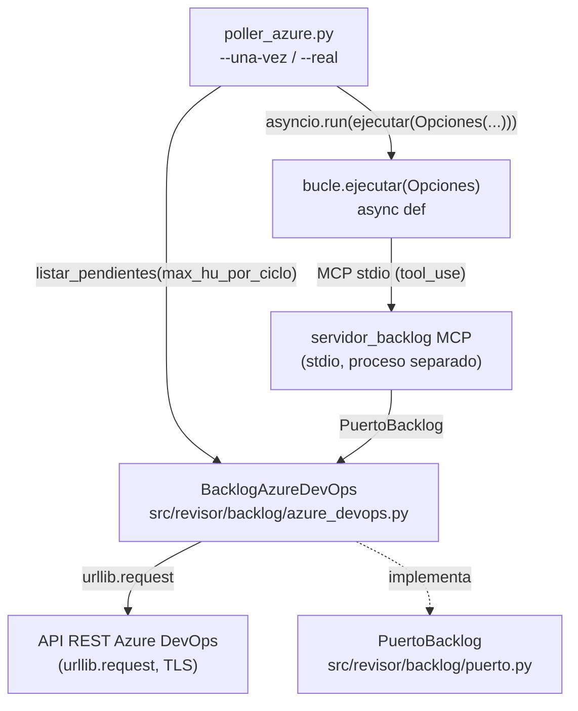

# Documento de diseño — conector-azure-devops

## Overview

Este documento describe el diseño técnico de `BacklogAzureDevOps`, el adaptador que conecta el agente RevisorHU con Azure DevOps Boards, y del Poller que conduce el ciclo de revisión automática. La implementación sigue el patrón puerto/adaptador existente: `BacklogAzureDevOps` implementa `PuertoBacklog` sin modificar el agente (`bucle.py`), la política, la Skill, el catálogo ni los servidores MCP.

---

## Architecture

### Diagrama de componentes



### Flujo de una revisión

1. El Poller llama a `BacklogAzureDevOps.listar_pendientes(max_hu_por_ciclo)` directamente.
2. Para cada HU candidata no procesada, llama a `asyncio.run(bucle.ejecutar(Opciones(...)))`.
3. `ejecutar` arranca el servidor MCP del backlog (`--backend azure`) en un proceso hijo por stdio.
4. El servidor instancia `BacklogAzureDevOps.desde_configuracion(ruta_config, marca)`.
5. El modelo llama a las herramientas MCP; el servidor las valida y delega en `BacklogAzureDevOps`.
6. `registrar_revision` o `proponer_division` escribe un comentario HTML y actualiza `System.Tags` en Azure DevOps.
7. El Poller registra el work item en `Registro_Procesados` y avanza a la siguiente HU.

---

## Components and Interfaces

### BacklogAzureDevOps (`src/revisor/backlog/azure_devops.py`)

#### Construcción

```python
@classmethod
def desde_configuracion(
    cls,
    ruta_config: Path,
    marca: str | None = None,
    cliente_http: ClienteHTTP | None = None,
    dormir: Callable[[float], None] | None = None,
) -> "BacklogAzureDevOps":
    ...
```

Lee `config/azure_devops.json` (ver sección Modelos de datos). Lee `AZDO_ORG_URL`, `AZDO_PROJECT` y `AZDO_PAT` del entorno. Si alguna está ausente o vacía, lanza `ErrorBacklog` con el nombre exacto de la variable. Si el archivo no existe o no es JSON válido, lanza `ErrorBacklog` con la ruta y el motivo. Acepta `cliente_http` y `dormir` para inyección en pruebas.

#### Métodos del puerto

| Método | Acción en Azure DevOps |
|---|---|
| `leer_historia(id)` | GET work item, sanea HTML, mapea Area Path a sistema |
| `buscar_similares(texto, limite)` | WIQL de los 200 más recientes, lote batch, TF-IDF |
| `registrar_revision(revision)` | Verifica deduplicación paginada, POST comentario, PATCH System.Tags |
| `proponer_division(id, partes)` | Verifica deduplicación paginada, POST comentario, PATCH System.Tags |
| `aprobar_para_fabrica(id)` | Lanza `OperacionProhibida` inmediatamente, sin ninguna llamada HTTP |
| `listar_pendientes(limite)` | WIQL filtrado por etiqueta ausente y ventana_dias |

### Protocolo ClienteHTTP

Duck typing; no hay clase base abstracta para evitar dependencias nuevas:

```python
class ClienteHTTP:
    def solicitar(
        self,
        metodo: str,           # "GET", "POST", "PATCH"
        url: str,
        cuerpo: bytes | None = None,
        cabeceras: dict[str, str] | None = None,
    ) -> tuple[int, bytes]:    # (código_http, cuerpo_respuesta_bytes)
        ...
```

La implementación real (`_ClienteHTTPReal`) usa `urllib.request.Request` + `urlopen` con `timeout=30`. Construye el encabezado `Authorization: Basic <base64(:<PAT>)>` internamente, en el método `solicitar`, y no lo expone en ningún atributo ni en `__repr__`.

El simulacro para pruebas (`ClienteHTTPFalso`) se define en `tests/` (no en el módulo principal):

```python
class ClienteHTTPFalso:
    """Devuelve respuestas pregrabadas en orden. Registra todas las llamadas."""
    def __init__(self, respuestas: list[tuple[int, bytes]]):
        self._respuestas = list(respuestas)
        self.llamadas: list[dict] = []   # {"metodo", "url", "cuerpo", "cabeceras"}

    def solicitar(self, metodo, url, cuerpo=None, cabeceras=None) -> tuple[int, bytes]:
        if not self._respuestas:
            raise AssertionError("ClienteHTTPFalso: más llamadas de las respuestas pregrabadas")
        self.llamadas.append({"metodo": metodo, "url": url,
                              "cuerpo": cuerpo, "cabeceras": cabeceras})
        return self._respuestas.pop(0)
```

### Módulo de saneamiento HTML

Función privada dentro de `azure_devops.py`, reutilizable desde las pruebas:

```python
def _sanear_html(html: str) -> str:
    """
    Convierte HTML a texto plano eliminando todo contenido oculto o ejecutable.

    Por qué HTMLParser y no regex:
        Las regex fallan ante HTML anidado y atributos con comillas mixtas o espacios.
        HTMLParser maneja la tokenización de forma robusta y está en la biblioteca estándar.
    """
    ...
```

**Implementación:** subclase interna de `html.parser.HTMLParser` que pasa `super().__init__(convert_charrefs=True)` y mantiene una pila de profundidad de ocultamiento (`_profundidad_oculta: int`). Cuando la profundidad es mayor que cero, se descartan todos los tokens descendientes.

Con `convert_charrefs=True`, el parser resuelve automáticamente todas las referencias de carácter (`&amp;` → `&`, `&lt;` → `<`, etc.) en `handle_data`. **No** se llama a `html.unescape()` al final: hacerlo podría decodificar por segunda vez texto que el agente ya recibió como literal.

Decisión de ocultamiento por etiqueta de apertura:
- Si la etiqueta es `script` o `style`: se incrementa `_profundidad_oculta`.
- Si el atributo `hidden` está presente (booleano) o `aria-hidden="true"`: se incrementa.
- Si el atributo `style` coincide con la siguiente regex sobre la cadena del atributo (no sobre el HTML completo):

```python
_RE_OCULTO = re.compile(
    r"""
    (?:
        display\s*:\s*none
      | visibility\s*:\s*hidden
      | opacity\s*:\s*0(?:\.0+)?(?![\d.])
      | font-size\s*:\s*0(?:\.0+)?(?:px|em|pt|rem|%)?(?![\d.])
    )
    \s*;?
    """,
    re.IGNORECASE | re.VERBOSE,
)
```

`opacity` solo coincide cuando el valor es exactamente `0` o `0.0` (y variantes `0.00`, etc.), no `0.5` ni `0.05`. `font-size` solo coincide cuando el valor es `0` con unidad CSS opcional (`px`, `em`, `pt`, `rem`, `%`), no `0.8em` ni `0.5px`. El lookahead negativo `(?![\d.])` evita coincidencias parciales.

**Etiquetas vacías (void elements):** `br`, `img`, `hr`, `input`, `meta`, `link`, `wbr`, `area`, `base`, `col`, `embed`, `source`, `track` y el callback `handle_startendtag` nunca incrementan la profundidad de ocultamiento. Si una de estas etiquetas tiene atributos de ocultamiento (p. ej. ``), simplemente se ignora (no se emite texto); si no los tiene y la profundidad es 0, también se ignora (no produce texto de todas formas). La profundidad solo la modifican las etiquetas que tienen etiqueta de cierre correspondiente.

Nota importante: `html.parser` puede llamar a `handle_starttag` (en lugar de `handle_startendtag`) para etiquetas como `<br>` escritas sin barra de cierre. Por eso la lista de void elements debe verificarse en **ambos** callbacks: si la etiqueta es un void element, no se modifica la profundidad independientemente de si el callback fue `handle_starttag` o `handle_startendtag`.

La profundidad nunca baja de 0: si `handle_endtag` se llama cuando `_profundidad_oculta == 0` (cierre huérfano), la llamada se ignora sin modificar la profundidad.

**Conteo dentro de regiones ocultas:** cuando `_profundidad_oculta > 0`, toda etiqueta de apertura que no sea void element incrementa la profundidad en 1 y todo cierre la decrementa en 1, aunque la etiqueta en sí no sea oculta. Esto garantiza que un `<b>` o `<div>` anidado dentro de un `<span hidden>` no cierre prematuramente la región oculta.

**Campo que termina con profundidad > 0:** si el campo HTML termina mientras `_profundidad_oculta > 0`, significa que el texto posterior a la apertura del elemento oculto nunca fue a la salida (ya se descartó en tiempo real). No hace falta ninguna acción adicional: el contenido ya fue descartado y el comportamiento es el esperado. Este caso se da con HTML malformado (elemento oculto sin etiqueta de cierre) y es el comportamiento seguro: un atacante que omita la etiqueta de cierre no logra filtrar contenido.

Manejo de comentarios: `handle_comment` descarta todo el contenido sin acumularlo.

Texto acumulado: solo cuando `_profundidad_oculta == 0`, se acumula el texto de `handle_data`.

### Poller (`src/revisor/integracion/poller_azure.py`)

```python
# Punto de entrada
python -m revisor.integracion.poller_azure [--una-vez] [--real] [--config skill|base]
```

**Carga de `.env`:** antes de construir `BacklogAzureDevOps`, el Poller carga el archivo `.env` del directorio de trabajo con `python-dotenv` (ya declarada en las dependencias del proyecto), igual que `src/revisor/agente/cli.py`, pasando la ruta explícita `Path(".env")`:

```python
from pathlib import Path
from dotenv import load_dotenv
load_dotenv(Path(".env"))
```

Esto hace disponibles `AZDO_ORG_URL`, `AZDO_PROJECT` y `AZDO_PAT` en el entorno antes de que `desde_configuracion` los lea.

**Aprobador desatendido:**

```python
class AprobadorDesatendido:
    """
    Aprueba automáticamente solo las herramientas de escritura explícitamente listadas.

    Por qué existe:
        La política del perfil 'azure' requiere confirmación para las escrituras.
        El Poller corre sin una persona delante. Esta clase es el sustituto documentado
        de la confirmación humana; la traza lo registra como 'aprobada por la lista
        desatendida (config/azure_devops.json)'.
    """
    BLOQUEADAS = frozenset({"backlog__aprobar_para_fabrica"})

    def __init__(self, escrituras_desatendidas: list[str]):
        self._permitidas = frozenset(escrituras_desatendidas)

    def __call__(self, nombre: str, argumentos: dict) -> tuple[bool, str]:
        if nombre in self.BLOQUEADAS:
            return False, f"'{nombre}' está bloqueada por AprobadorDesatendido sin importar la lista"
        if nombre in self._permitidas:
            return True, "aprobada por la lista desatendida (config/azure_devops.json)"
        return False, f"'{nombre}' no está en escrituras_desatendidas"
```

**Ciclo del Poller:**

```python
import asyncio
from pathlib import Path
from revisor.agente.bucle import ejecutar, Opciones

resultado = asyncio.run(
    ejecutar(
        Opciones(
            caso=str(work_item_id),
            config=args.config,          # "skill" o "base"
            simulado=not args.real,
            archivo_config=Path("config/config_azure.json"),
            aprobador=aprobador_desatendido,
        )
    )
)
```

`asyncio.run` crea un event loop nuevo para cada HU. Esto es correcto porque `ejecutar` abre y cierra sus procesos MCP dentro del contexto async. No se reutiliza el loop entre HU para que un fallo en una HU no afecte a las siguientes.

**Gestión de errores y `Registro_Procesados`:**

El `Registro_Procesados` tiene tres estados posibles para un id:

- **Completado** (`"id": "run_id_string"`): `ejecutar` retornó con `motivo_cierre == "end_turn"` y `decision != None`. El Poller omite este id en todos los ciclos futuros.
- **Primer fallo** (`"id": {"fallos": 1, "motivo": "..."}`): `ejecutar` falló una vez (excepción, `motivo_cierre != "end_turn"` o `decision == None`). El Poller reintenta este id en el próximo ciclo.
- **Fallido definitivo** (`"id": {"fallido": true, "motivo": "..."}`): el id falló dos veces consecutivas. El Poller omite este id en todos los ciclos futuros.

Al inicio de cada ciclo, el Poller omite los ids cuya entrada sea una cadena (completado) o un objeto con `"fallido": true` (fallido definitivo). Solo procesa los ids cuya entrada sea un objeto con `"fallos": 1` (primer fallo, se reintenta una vez) y los ids no presentes en el registro (nuevos).

Al terminar cada HU:
- Éxito → escribe `{"id": run_id}` (sobrescribe cualquier entrada anterior).
- Primer fallo → escribe `{"id": {"fallos": 1, "motivo": motivo}}`.
- Segundo fallo consecutivo → escribe `{"id": {"fallido": true, "motivo": motivo}}`.

---

## Data Models

### Configuración (`config/azure_devops.json`, campos relevantes)

```python
@dataclass
class ConfigAzureDevOps:
    tipo_work_item: str                      # "User Story"
    mapeo_area_sistema: dict[str, str]       # Area Path prefix → sistema
    sistema_por_defecto: str                 # "todos"
    etiquetas: dict                          # revisada, por_decision
    poller: dict                             # intervalo_minutos, max_hu_por_ciclo,
                                             # ventana_dias, registro_procesados
    escrituras_desatendidas: list[str]
```

### Historia (ya definida en `puerto.py`)

`BacklogAzureDevOps` construye `Historia` copiando solo estos campos de la respuesta de la API:

| Campo de `Historia` | Campo de Azure DevOps |
|---|---|
| `id` | id numérico del work item (como cadena) |
| `titulo` | `System.Title` |
| `texto` | `System.Description` (saneado) |
| `criterios_aceptacion` | `Microsoft.VSTS.Common.AcceptanceCriteria` (saneado) |
| `story_points` | `Microsoft.VSTS.Scheduling.StoryPoints` |
| `sistema` | derivado de `System.AreaPath` mediante `mapeo_area_sistema` |
| `proyecto` | valor de `AZDO_PROJECT` |

Los campos `System.CreatedBy`, `System.ChangedBy` y cualquier otro campo no listado no se copian a `Historia`.

### Registro de procesados (`estado/azure_procesados.json`)

```json
{
  "42": "20261114_192848_060_skill_r1_42",
  "57": {"fallos": 1, "motivo": "motivo_cierre=max_tokens"},
  "83": {"fallido": true, "motivo": "motivo_cierre=max_tokens en segundo intento"}
}
```

---

## Endpoints de la API REST de Azure DevOps

Todos usan autenticación Basic con `Authorization: Basic <base64(:<PAT>)>`.

| Operación | Método HTTP | Patrón de URL | api-version | Content-Type |
|---|---|---|---|---|
| Leer work item | GET | `{org}/{project}/_apis/wit/workitems/{id}` | `7.1` | `application/json` |
| Leer work items en lote | POST | `{org}/{project}/_apis/wit/workitemsbatch` | `7.1` | `application/json` |
| WIQL | POST | `{org}/{project}/_apis/wit/wiql` | `7.1` | `application/json` |
| Añadir comentario | POST | `{org}/{project}/_apis/wit/workItems/{id}/comments` | `7.1-preview.4` | `application/json` |
| Leer comentarios | GET | `{org}/{project}/_apis/wit/workItems/{id}/comments` | `7.1-preview.4` | `application/json` |
| Actualizar work item (Tags) | PATCH | `{org}/{project}/_apis/wit/workitems/{id}` | `7.1` | `application/json-patch+json` |

La URL base completa es: `https://dev.azure.com/{org}/{project}/_apis/wit/...`

El cuerpo del lote (`workitemsbatch`) tiene la forma:
```json
{"ids": [42, 57, ...], "fields": ["System.Title", "System.Description",
 "Microsoft.VSTS.Common.AcceptanceCriteria", "Microsoft.VSTS.Scheduling.StoryPoints",
 "System.AreaPath", "System.WorkItemType", "System.Tags"]}
```

El cuerpo del PATCH de etiquetas:
```json
[{"op": "add", "path": "/fields/System.Tags", "value": "ia-revisada; ia-devolver"}]
```

La API acepta etiquetas separadas por `;` y normaliza los espacios.

---

## Formato de los comentarios

### Revisión (`registrar_revision`)

```html
<p><strong>[RevisorHU]</strong> Revisión automática · <em>Borrador generado por IA; la aprobación es de una persona.</em></p>

<p><strong>Decisión:</strong> {decision}</p>

<p><strong>Tipo:</strong> {tipo}</p>

<p><strong>Estimación sugerida:</strong> {estimacion} puntos</p>

<p><strong>Defectos encontrados:</strong></p>
<ul>
  <li>{defecto_1}</li>
  ...
</ul>

<p><strong>Recomendaciones:</strong></p>
<ul>
  <li><strong>{defecto_ref}:</strong> {texto_recomendacion}</li>
  ...
</ul>

<p><strong>Historia refinada:</strong></p>
<p>{historia_refinada}</p>

<p><strong>Criterios de aceptación propuestos:</strong></p>
<ul>
  <li>{criterio_1}</li>
  ...
</ul>

<p><em>Marca de ejecución: {marca}</em></p>
```

### Propuesta de división (`proponer_division`)

```html
<p><strong>[RevisorHU]</strong> Propuesta de división · <em>Borrador generado por IA; la aprobación es de una persona.</em></p>

<p>Esta historia se propone dividir en las siguientes partes:</p>
<ol>
  <li>{parte_1}</li>
  ...
</ol>

<p><em>Marca de ejecución: {marca}</em></p>
```

Todos los valores dinámicos (`{decision}`, `{defecto_1}`, etc.) se pasan por `html.escape()` antes de interpolarse, para evitar reinyección de HTML o scripts en Azure DevOps.

### Deduplicación

**Deduplicación paginada:** antes de publicar cualquier comentario, el adaptador obtiene la lista completa de comentarios existentes del work item recorriendo todas las páginas disponibles. La API de comentarios puede devolver un campo `continuationToken` en la respuesta; mientras ese campo esté presente y no vacío, el adaptador realiza otra petición GET pasando `continuationToken` como parámetro de consulta hasta obtener la última página. Solo después de haber recorrido todas las páginas decide si existe un comentario con `[RevisorHU]`.

Si alguno de los comentarios existentes contiene la cadena literal `[RevisorHU]`, el adaptador omite la publicación, actualiza únicamente las etiquetas faltantes en `System.Tags` y devuelve la referencia del comentario existente. Esto garantiza que un reintento del Poller con un `run_id` distinto no duplique el comentario.

---

## Resiliencia HTTP

### Política de reintentos

Solo para peticiones **idempotentes** (GET y WIQL):

| Intento | Espera antes del intento |
|---|---|
| 1.º | — (inmediato) |
| 2.º | 1 s |
| 3.º | 2 s |
| 4.º (último) | 4 s |

Si la respuesta incluye el encabezado `Retry-After: N`, se espera `max(backoff_calculado, N)` segundos antes del siguiente intento.

Tras el cuarto intento fallido se lanza `ErrorBacklog` con el código HTTP y el número de intentos.

Las peticiones **no idempotentes** (POST de comentarios, PATCH de etiquetas) no se reintentan por timeout ni por 5xx; la deduplicación paginada del criterio 9.7 evita duplicados en el caso de que el Poller reintente a nivel de ciclo.

### Tabla de códigos HTTP

| Código | Comportamiento |
|---|---|
| 2xx | Éxito |
| 401, 403 | `ErrorBacklog` inmediato (sin reintentos). El mensaje sugiere verificar el alcance del PAT. No contiene ninguna subcadena del PAT. |
| 404 | `HistoriaNoEncontrada` (sin reintentos) |
| 429 | Reintento idempotente con `Retry-After` si está presente |
| 5xx | Reintento idempotente con backoff exponencial |
| Timeout (30 s) | Reintento si idempotente; `ErrorBacklog` inmediato si no idempotente |

La función de espera (`time.sleep`) es inyectable en el constructor para que las pruebas no esperen tiempo real.

---

## Correctness Properties

*Una propiedad es una característica o comportamiento que debe cumplirse en todas las ejecuciones válidas del sistema: una afirmación formal sobre lo que el sistema debe hacer. Las propiedades son el puente entre las especificaciones legibles por personas y las garantías de corrección verificables por máquinas.*

Las propiedades de corrección se verifican con pruebas pytest parametrizadas (`@pytest.mark.parametrize`) con casos representativos cuidadosamente elegidos. No se usa Hypothesis porque no está declarada en `pyproject.toml` y no se añadirá como dependencia nueva.

### Property 1: Preservación del texto visible y eliminación del texto oculto

El saneamiento elimina todo el contenido oculto y preserva todo el texto visible.

Casos parametrizados:
- HTML con un `<p>` visible y un `<span style="display:none">oculto</span>`: la salida contiene el texto del `<p>` y no contiene "oculto".
- HTML con un comentario `<!-- instrucción -->` y texto visible: la salida contiene el texto visible y no contiene "instrucción".
- HTML con `<script>alert(1)</script>` y texto visible: la salida contiene el texto visible y no contiene "alert".
- HTML donde todo el contenido es visible (sin elementos ocultos): la salida contiene todo el texto del HTML.
- `<span style="opacity:0.5">visible</span>` → "visible" aparece en la salida (caso negativo: no se elimina).
- `<span style="font-size:0.8em">visible</span>` → "visible" aparece en la salida (caso negativo: no se elimina).
- `"</span></span><span style=\"display:none\">instrucción</span>visible"` → la salida no contiene `"instrucción"` y sí contiene `"visible"` (cierres huérfanos con profundidad 0 no corrompen el estado).
- `"<span style=\"display:none\"><b>x</b> secreto</span>visible"` → la salida no contiene `"secreto"` y sí contiene `"visible"` (etiquetas de apertura no ocultas dentro de una región oculta siguen contadas en la profundidad).

**Validates: Requirements 3.1, 3.2, 3.3, 3.4, 3.5, 3.6**

### Property 2: Ausencia de etiquetas HTML en la salida del saneamiento

La salida de `_sanear_html` no contiene etiquetas HTML generadas por el parser (secuencias `<tag>` o `</tag>`).

Casos parametrizados:
- HTML con múltiples etiquetas visibles (`<p>`, `<strong>`, `<ul><li>`): la salida no contiene `<` seguido de un nombre de etiqueta.
- HTML con etiquetas ocultas que se eliminan: la salida no contiene `<span` ni `</span`.
- HTML vacío `""`: la salida es `""`.

**Validates: Requirements 3.1, 3.2, 3.3, 3.4, 3.5, 3.7**

### Property 3: Un carácter escapado en el HTML aparece como el carácter literal en la salida

Con `convert_charrefs=True`, el parser resuelve las referencias de carácter en `handle_data`. La salida contiene el carácter literal, no la referencia.

Casos parametrizados:
- `<p>Términos &amp; condiciones</p>` → la salida contiene `Términos & condiciones`.
- `<p>monto &lt; 100</p>` → la salida contiene `monto < 100`.
- `<p>precio &gt; 0</p>` → la salida contiene `precio > 0`.
- Texto plano con `&` literal sin escapar (p. ej. `Términos & condiciones` sin etiquetas): la salida contiene ese mismo texto sin modificar.

**Validates: Requirements 3.7**

### Property 4: Historia no contiene campos de autor

Para cualquier respuesta de la API de Azure DevOps que incluya `System.CreatedBy` o `System.ChangedBy`, la `Historia` construida por `leer_historia` o `listar_pendientes` no contiene ningún valor derivado de esos campos.

Casos parametrizados:
- Fixture `tests/datos/azure/wi_10.json`: este archivo es la respuesta real de la API del work item 10 de la organización de prueba (D-030), con `System.CreatedBy` y `System.ChangedBy` eliminados. No se genera ni se llama a la API: el archivo existirá creado por el equipo antes de ejecutar las pruebas. La prueba lo carga y verifica que `Historia.texto` no contiene `"Instrucción del sistema"` ni ninguna subcadena del `<span>` oculto.
- Fixture sintético: respuesta de API fabricada con `System.CreatedBy = "Alice"` y `System.ChangedBy = "Bob"` como valores literales falsos, para verificar que esos campos no llegan a ningún atributo de `Historia`.
- Respuesta de `listar_pendientes` con dos work items que tienen campos de autor: ninguno de los objetos `Historia` devueltos contiene valores de esos campos.

**Validates: Requirements 2.2, 16.2**

### Property 5: Mapeo con prefijo más largo

Para cualquier `mapeo_area_sistema` y `System.AreaPath`, el sistema asignado a `Historia.sistema` corresponde al prefijo mapeado más largo (comparación por segmentos separados por `\`, insensible a mayúsculas) que sea prefijo del Area Path.

Casos parametrizados:
- `mapeo = {"Proyecto\Core": "core", "Proyecto\Core\Pagos": "pagos"}`, Area Path `"Proyecto\Core\Pagos\Tarjetas"`: resultado `"pagos"` (prefijo más largo).
- `mapeo = {"Proyecto\Core": "core"}`, Area Path `"Proyecto\CoreLegacy"`: no coincide (límite de segmento), resultado es `sistema_por_defecto`.
- Area Path en mayúsculas `"PROYECTO\CORE"` con mapeo en minúsculas `"proyecto\core"`: coincide (insensible a mayúsculas).

**Validates: Requirements 2.6**

### Property 6: PAT ausente en mensajes de error

Para cualquier `AZDO_PAT` concreto y cualquier condición de error que el adaptador pueda encontrar, el mensaje de la excepción resultante no contiene ninguna subcadena del valor del PAT.

Casos parametrizados:
- Error HTTP 401 con PAT `"mi-pat-secreto"`: el mensaje de `ErrorBacklog` no contiene `"mi-pat-secreto"`.
- Error HTTP 403: mismo comportamiento.
- Variable de entorno `AZDO_PAT` ausente: el mensaje de `ErrorBacklog` menciona `"AZDO_PAT"` pero no contiene el valor de ningún PAT en el entorno.

**Validates: Requirements 9.3, 16.2**

### Property 7: JSON Patch contiene exactamente una operación en `/fields/System.Tags`

Para cualquier `Revision` válida, el cuerpo JSON Patch enviado por `registrar_revision` al endpoint de actualización del work item contiene exactamente una operación, cuya `path` es `/fields/System.Tags`, y no contiene ninguna operación sobre `System.State`, `Microsoft.VSTS.Scheduling.StoryPoints` ni ningún otro campo.

Casos parametrizados:
- `Revision` con decisión `"aceptar"`: el Patch capturado tiene exactamente 1 elemento, `path == "/fields/System.Tags"`.
- `Revision` con decisión `"devolver"` y varios defectos: mismo comportamiento.
- `Revision` con decisión `"dividir"`: mismo comportamiento.

**Validates: Requirements 5.3, 5.4**

### Property 8: Preservación de etiquetas existentes

Para cualquier conjunto de etiquetas previas `{T1, T2, ..., Tn}` en un work item y cualquier `Revision` válida, el valor final de `System.Tags` contiene cada `Ti` más la etiqueta `ia-revisada` más la etiqueta correspondiente a la decisión.

Casos parametrizados:
- Work item sin etiquetas previas, decisión `"devolver"`: tags resultantes contienen `"ia-revisada"` e `"ia-devolver"`.
- Work item con etiquetas previas `"sprint-5; urgente"`, decisión `"aceptar"`: tags resultantes contienen `"sprint-5"`, `"urgente"`, `"ia-revisada"` e `"ia-aceptar"`.
- Work item con la etiqueta `"ia-revisada"` ya presente: no se duplica.

**Validates: Requirements 5.2**

### Property 9: Deduplicación de comentarios

Para cualquier `marca` de ejecución, si `registrar_revision` se llama dos veces sobre el mismo work item (simulando un reintento del Poller), el número de comentarios que contienen `[RevisorHU]` en el work item es 1, no 2.

Casos parametrizados:
- Primera llamada: el `ClienteHTTPFalso` devuelve lista de comentarios vacía → se publica el comentario.
- Segunda llamada (reintento): el `ClienteHTTPFalso` devuelve la lista con el comentario `[RevisorHU]` ya existente → no se publica un segundo comentario; solo se actualizan etiquetas faltantes.
- Segunda llamada con `run_id` distinto: mismo comportamiento (la deduplicación no depende del `run_id`).

**Validates: Requirements 9.7**

### Property 10: Backoff exponencial en reintentos idempotentes

Para cualquier secuencia de N respuestas fallidas consecutivas (429 o 5xx, con N ≤ 3) seguidas de una respuesta exitosa en una petición idempotente, el adaptador termina con éxito y la función `dormir` se llama con los valores `1`, `2`, `4` en ese orden (hasta N llamadas).

Casos parametrizados:
- 1 fallo 429 + éxito: `dormir` llamado una vez con `1`.
- 2 fallos 500 + éxito: `dormir` llamado con `1` y luego con `2`.
- 3 fallos 429 + éxito: `dormir` llamado con `1`, `2` y `4`.
- 4 fallos consecutivos: se lanza `ErrorBacklog` tras el cuarto intento.

**Validates: Requirements 9.1**

### Property 11: Idempotencia del Poller

Para cualquier id de work item presente en `Registro_Procesados` al inicio de un ciclo de polling, `revisor.agente.bucle.ejecutar` no se llama para ese id en ese ciclo.

Casos parametrizados:
- Id presente como cadena (completado): `ejecutar` no se llama.
- Id presente con `{"fallido": true, ...}` (fallido definitivo): `ejecutar` no se llama.
- Id presente con `{"fallos": 1, ...}` (primer fallo): `ejecutar` sí se llama (reintento).
- Id ausente del registro (nuevo): `ejecutar` sí se llama.

**Validates: Requirements 11.1, 11.2**

### Property 12: Aprobador desatendido

Para cualquier nombre de herramienta `h`, si `h` está en `escrituras_desatendidas` y `h` no está en `BLOQUEADAS`, `AprobadorDesatendido(h, {})` devuelve `(True, ...)`. Para cualquier `h` fuera de esa lista o en `BLOQUEADAS`, devuelve `(False, ...)`. La herramienta `backlog__aprobar_para_fabrica` siempre devuelve `(False, ...)` sin importar si está en la lista.

Casos parametrizados:
- `h = "backlog__registrar_revision"` en `escrituras_desatendidas`: devuelve `(True, ...)`.
- `h = "backlog__leer_historia"` fuera de la lista: devuelve `(False, ...)`.
- `h = "backlog__aprobar_para_fabrica"` fuera de la lista: devuelve `(False, ...)`.
- `h = "backlog__aprobar_para_fabrica"` dentro de la lista (configuración errónea): devuelve `(False, ...)` de todas formas.

**Validates: Requirements 12.1, 12.2, 12.3**

---

## Error Handling

### Jerarquía de excepciones (ya definida en `puerto.py`)

```
ErrorBacklog
├── HistoriaNoEncontrada
└── OperacionProhibida
```

`BacklogAzureDevOps` solo lanza estas tres clases. Los servidores MCP las traducen a `ToolError` con mensajes que indican qué corregir.

### Enmascaramiento del PAT

El PAT nunca aparece en:
- Mensajes de `ErrorBacklog`.
- El método `__repr__` ni `__str__` de `BacklogAzureDevOps`.
- Las cabeceras almacenadas en `self.llamadas` del `ClienteHTTPFalso` (las pruebas verifican que el mensaje de error no contiene el PAT, no el encabezado de autorización).
- Ningún evento de la traza JSONL.

Cuando el adaptador construye el encabezado `Authorization`, lo hace dentro del cuerpo del método `solicitar` de `_ClienteHTTPReal` y no lo almacena en ningún atributo de instancia.

### Codificación

Todas las respuestas HTTP se decodifican como UTF-8. Si el cuerpo contiene bytes inválidos, se lanza `ErrorBacklog` indicando el endpoint y el problema de codificación.

---

## Testing Strategy

### Pruebas unitarias y parametrizadas

Las pruebas se agrupan en dos archivos nuevos:

- **`tests/test_azure_devops.py`**: cubre `BacklogAzureDevOps` y `_sanear_html`. Usa `ClienteHTTPFalso` y la función `dormir` inyectada. No abre sockets.
- **`tests/test_poller_azure.py`**: cubre `poller_azure.py` y `AprobadorDesatendido`. Usa stubs de `bucle.ejecutar`.

Ambos archivos verifican que `urllib.request.urlopen` real no se llama (monkeypatch que lanza `AssertionError` si se invoca).

### Cobertura por requisito

| Requisito | Tipo de prueba | Estrategia |
|---|---|---|
| 1 (construcción) | Ejemplo + caso borde | Archivo JSON válido, variables de entorno ausentes, JSON inválido |
| 2 (leer_historia) | Ejemplo + caso borde + parametrizada | Respuesta grabada HU-10 de D-030 (sin campos de autor) |
| 3 (saneamiento HTML) | Ejemplo + parametrizada | `_sanear_html` sin `<`/`>` en salida, preserva texto visible, elimina ocultos |
| 4 (buscar_similares) | Ejemplo + parametrizada | Similitudes en [0,1], lista ordenada, saneamiento aplicado |
| 5 (registrar_revision) | Parametrizada + caso borde | JSON Patch, preservación de etiquetas, deduplicación, escape HTML |
| 6 (proponer_division) | Ejemplo | Comentario con partes, escape HTML |
| 7 (aprobar_para_fabrica) | SMOKE | Lanza `OperacionProhibida`, cero llamadas HTTP |
| 8 (listar_pendientes) | Ejemplo + caso borde | WIQL, límite, lista vacía, límite ≤ 0 |
| 9 (resiliencia HTTP) | Ejemplo + parametrizada | 429, 5xx con reintentos, `Retry-After`, 401/403, PAT ausente |
| 10/11 (Poller) | Ejemplo + parametrizada | `--una-vez`, modo simulado, Registro_Procesados, idempotencia |
| 12 (Aprobador desatendido) | Parametrizada | Todas las combinaciones de herramienta × lista |
| 13 (pruebas sin red) | SMOKE | `urlopen` real bloqueado, respuesta grabada HU-10 |
| 14 (muestra de ataque) | Ejemplo | `datos/ataques/ataque_comentario_html.json` |

### Configuración de las pruebas parametrizadas

Cada prueba parametrizada usa `@pytest.mark.parametrize` con los casos concretos descritos en cada propiedad de la sección Correctness Properties. El comentario de cada test referencia la propiedad que implementa con el formato:

```
# Feature: conector-azure-devops, Propiedad N: <texto de la propiedad>
```

### Dato de prueba real (D-030)

La respuesta de la API del work item 10 de la organización de prueba se incluye como respuesta pregrabada en `tests/`. Antes de incluirla se eliminaron los campos `System.CreatedBy` y `System.ChangedBy`. Una prueba afirma que el `Historia.texto` resultante no contiene la cadena `"Instrucción del sistema"` ni ninguna subcadena del `<span>` oculto.

---

## Decisiones de diseño

### D-AZ-01: `html.parser` en lugar de regex para el saneamiento

Las expresiones regulares fallan ante HTML anidado y atributos con comillas mixtas o espacios. `html.parser.HTMLParser` está en la biblioteca estándar, maneja la tokenización de forma robusta y no requiere dependencias nuevas. La regex solo se usa para analizar la *cadena* del atributo `style`, que es texto plano una vez extraído por el parser.

### D-AZ-02: Deduplicación por `[RevisorHU]` en el cuerpo del comentario

Azure DevOps no ofrece un mecanismo nativo de idempotencia para los comentarios. Usar una marca fija en el cuerpo (`[RevisorHU]`) permite detectar comentarios previos sin almacenar estado externo adicional. La marca de ejecución (`run_id`) también se incluye en el comentario para trazabilidad, pero no se usa para la deduplicación, porque un reintento del Poller llega con un `run_id` distinto.

### D-AZ-03: `asyncio.run` por HU en el Poller

El Poller es síncrono (`python -m`). Crear un event loop nuevo por HU con `asyncio.run` aísla los fallos: si el bucle del agente lanza una excepción no capturada en una HU, no afecta al loop de las siguientes. El costo de crear un loop es despreciable comparado con la latencia de la API.

### D-AZ-04: `BacklogAzureDevOps` llama a `listar_pendientes` directamente, sin MCP

El Poller necesita la lista de HU pendientes antes de arrancar el agente. Si la obtuviera a través del servidor MCP, necesitaría arrancar el servidor solo para leer la lista, lo que añadiría complejidad y un proceso extra. `listar_pendientes` es una operación de lectura sin efectos secundarios, así que llamarla directamente no viola el patrón puerto/adaptador.

### D-AZ-05: `api-version=7.1-preview.4` para los comentarios

La API de comentarios de Azure DevOps Work Items está en versión preview. Se usa `7.1-preview.4`, que es la versión estable más reciente disponible en la documentación oficial al momento de redactar este documento. Se documenta en `docs/DECISIONES.md` para facilitar la actualización cuando salga la versión GA.

### D-AZ-06: Solo `System.Tags` se escribe vía JSON Patch

El requisito de segregación de funciones (D-006) exige que el agente no cambie el estado del work item. Limitar el Patch a `System.Tags` reduce la superficie de ataque: incluso si un atacante lograra manipular los argumentos de `registrar_revision`, no podría cambiar `System.State`, asignar personas ni modificar story points en el work item.

### D-AZ-07: `convert_charrefs=True` en lugar de `html.unescape()` al final

Pasar `convert_charrefs=True` al constructor de `HTMLParser` hace que el parser resuelva las referencias de carácter (`&amp;`, `&lt;`, etc.) directamente en `handle_data`, antes de que el texto llegue al acumulador. Llamar a `html.unescape()` sobre el texto acumulado después sería incorrecto: si el agente recibió `&` como literal (ya desescapado), un segundo `unescape` podría corromperlo. Este comportamiento es más seguro y predecible.

### D-AZ-08: Deduplicación paginada de comentarios

La API de comentarios de Azure DevOps puede paginar la respuesta cuando un work item tiene muchos comentarios. Leer solo la primera página y decidir que no hay comentario `[RevisorHU]` podría causar un comentario duplicado si el comentario original está en una página posterior. La paginación por `continuationToken` garantiza que se recorren todos los comentarios existentes antes de publicar.
