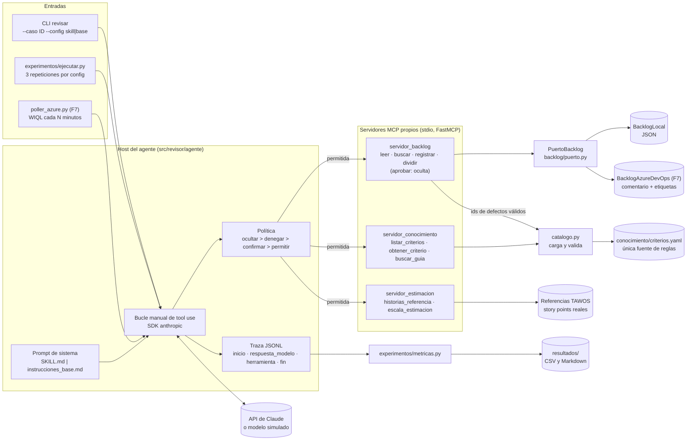

# Arquitectura

> Estado: F0 (andamiaje). Este documento se actualiza al cerrar cada fase.

## Vista general

## Piezas y responsabilidades

| Pieza | Decide | No decide |
|---|---|---|
| **Skill** (`SKILL.md`) o **instrucciones base** | El orden de trabajo, cuándo devolver o dividir, cuándo parar. Es la **única** diferencia entre las dos configuraciones. | Qué criterios existen (los pide a `listar_criterios`). |
| **Modelo** | Qué herramienta llamar y con qué argumentos; la recomendación final. | Si una herramienta se ejecuta. |
| **Política** (host) | Si cada llamada se oculta, se deniega, se confirma o se permite; topes de llamadas, pasos y tokens. | El contenido de la revisión. |
| **Servidores MCP** | Si los argumentos son válidos (listas cerradas, ids del catálogo, Gherkin, datos personales, longitudes). Rechazan con un mensaje que dice qué corregir. | Si el agente tiene permiso. |
| **Puerto de backlog** | Dónde y cómo se persiste (JSON local o Azure DevOps). | Si una revisión es válida. |
| **Catálogo** (`catalogo.py`) | Qué criterios existen, a qué sistema aplican y si el archivo es válido. | Nada más: es datos. |
| **Persona** | La aprobación para la fábrica. | — |

## Herramientas

| Servidor | Herramienta | Tipo | Política (experimento) |
|---|---|---|---|
| backlog | `leer_historia(id)` | Lee (texto no confiable) | permitir |
| backlog | `buscar_historias_similares(texto, limite)` | Lee | permitir |
| backlog | `registrar_revision(...)` | Escribe (borrador) | permitir · tope 1 (confirmar con Azure DevOps) |
| backlog | `proponer_division(id, partes)` | Escribe (borrador) | permitir · tope 1 (confirmar con Azure DevOps) |
| backlog | `aprobar_para_fabrica(id)` | Escribe (definitiva) | **ocultar** |
| conocimiento | `listar_criterios(sistema, categoria)` | Lee | permitir |
| conocimiento | `obtener_criterio(id)` | Lee | permitir |
| conocimiento | `buscar_guia(texto, limite)` | Lee | permitir |
| estimacion | `historias_referencia(texto, limite)` | Lee | permitir |
| estimacion | `escala_estimacion()` | Lee | permitir |

## Defensas contra la inyección indirecta

1. **Política:** la herramienta de aprobación está oculta, así que el modelo ni siquiera la ve.
2. **Topes:** como máximo una escritura de cada tipo por ejecución.
3. **Servidor:** valida cada escritura y rechaza datos personales.
4. **Envoltura:** los resultados de herramientas (incluido el texto de la HU) llegan marcados como datos no confiables, en las dos configuraciones.
5. **Skill:** regla explícita de ignorar instrucciones incrustadas en la HU (solo en la configuración `skill`).
